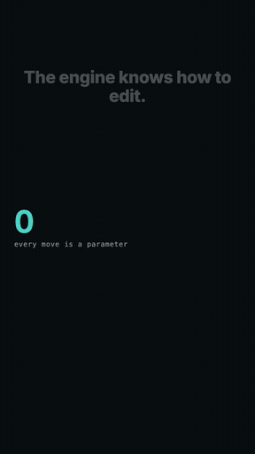

# Reel Studio

A short-form video editor you drive with a coding agent. Footage and a brief go
in; a verified, delivery-spec vertical MP4 comes out. Every creative decision is
input, so it cuts a hook reel one week and a screen-recording walkthrough the
next without changing the tool.

It runs locally. Nothing in it costs money, calls an API, or needs an account.



*Rendered by `npm run render 000-smoke-test` — generated sources only, no
footage. It is the engine's test fixture, deliberately packed with every kind of
move; a real reel carries a handful, not all of them (see `STYLE.md`).*

## Requirements

- macOS or Linux, Node 22 or newer
- `ffmpeg` — `brew install ffmpeg`
- `uv`, only for transcription — `brew install uv`
- **Transcription needs an Apple Silicon Mac.** `npm run transcribe` runs
  `mlx-whisper`, which is built on Apple's MLX. Everything else (render, check,
  screenshots, formats, the studio) runs on Linux and Intel Macs too; there, supply
  the word timings yourself (below).

### Word timings without the built-in transcription

Anywhere `npm run transcribe` cannot run, produce `words.json` with any Whisper tool
(whisper.cpp, faster-whisper, a hosted service) and put it in the post's folder. It is
one list of words per media key, times in milliseconds:

```json
{ "voice": [ { "text": "Hello", "startMs": 0, "endMs": 320, "timestampMs": 160, "confidence": 0.9 } ] }
```

`timestampMs` and `confidence` may be `null`. Also write `transcript.md` (plain text, a
`[seconds]` marker at the start of each line) if you want a coding agent to read the
words cheaply instead of the JSON. Pass `--force` to `npm run transcribe` to try
`mlx-whisper` on another chip anyway.

## Setup

```bash
npm install
npm run doctor                 # checks Node, ffmpeg and uv, and says what to install
npm run render 000-smoke-test
```

The smoke test uses only generated sources, so it renders on a clean checkout
with no footage. If it produces an MP4, everything works.

## Cutting a reel

```bash
npm run new 001-my-reel
```

Then drop footage into `public/posts/001-my-reel/raw/`, write `brief.md` using
the templates in `DIRECTION.md`, and:

```bash
npm run ingest 001-my-reel
npm run transcribe 001-my-reel
npm run studio                 # live preview while you iterate
npm run render 001-my-reel     # render, normalise loudness, verify
```

## Using it with an AI agent

The only part that needs an AI is writing the shotlist — the file that says
which move sits at which word. Everything else (measuring, transcribing,
rendering, verifying) is plain code and costs no tokens.

Open the folder in any coding agent — Claude Code, Codex, Gemini CLI, Cursor —
and say "cut post 001". `AGENTS.md` carries the whole procedure and every rule,
so the agent knows it without you explaining anything. Claude Code reads it
through the one-line `CLAUDE.md` that points at it; other agents read
`AGENTS.md` directly. The slash commands in `.claude/` are a Claude Code
convenience, not a requirement.

## Where briefs come from

If scripts are written somewhere else, hand that project `ENGINE.md` (what the
editor can do), `HANDOFF.md` (exactly what a brief contains, including the
word-count budget that keeps a script inside its runtime, and a checklist to run
before handing anything over) and `STYLE.md` (how many effects a reel can
carry). A complete brief is cut in one pass; an incomplete one becomes three
rounds of questions.

## What it does

**Measures instead of assuming.** Shot durations come from the files. Scripts
under-budget speaking time badly, so no scripted timing is ever trusted.

**Anchors edits to spoken words.** `at.start("generated")` survives a re-cut; a
timecode does not. Captions, titles, marks, zooms and slams all land on the word
that names them.

**Cuts like an editor.** Punches, matched zooms, blends, slides, split edits
(sound changing before or after the picture), B-roll that keeps the voice
running underneath, dead air and "um"s removed from the actual recording,
music that ducks under speech and can start on a real beat.

**Presents screen recordings properly.** A recording can float as a rounded
card over a blurred copy of itself and swing in with a 3D turn; hand-drawn
circles, underlines and highlights draw themselves over one thing; clicks get a
ring and an optional spotlight; the picture zooms toward a click; footage can
race and ease back to normal speed.

**Makes moments land.** A key word slams into the middle of the frame, sized to
fit; the picture can shake, flash or glitch. Small sounds play on clicks, marks
and zooms by themselves. `STYLE.md` says how few of the loud ones a reel should
carry, and `npm run critique` counts them.

**Generates picture when you have none.** Diagrams whose icons draw
themselves on, code with real syntax colouring that morphs from one version to
the next, terminals, comparisons, counters and trends, callouts, imported
Lottie animations, and a dotted "thinking" orb — all rendered from the same
program as the word timings, so a diagram advances on the word you say it.

**Builds a whole reel from content when nobody is on screen.** Give it a voice
and a list (five tools, or the steps of how something works), and it writes the
shotlist: each section starts on the phrase that names it, and everything inside
— a row landing, a dot leaving a server — appears on the word that names it, so
re-recording the voice moves the whole edit. `npm run snap` screenshots a page and an image clip shows it in a browser window that scrolls down it, with marks that stay on the line they mark. `npm run check` reads the shotlist
for mistakes before any render is spent.

**Fixes round-trip drift.** Audio that went through an external repair tool comes
back a frame or two out. `npm run align` measures the offset by correlation and
corrects it.

**Verifies the file, not the intention.** Frame size, rate, runtime ceiling,
codec, file size and measured loudness, plus frames pulled out to look at. Every
render is also saved as a take you can list, diff and restore.

## Making it yours

Copy `projects/default/tokens.ts`, change every value in it, and point your
shotlists at the copy. That file holds the whole look: palette, fonts, caption
style, safe zones, punch presets, mix levels, and the style of every overlay
and effect. One repository can serve several channels without them
contaminating each other.

## Documentation

Seven files, each for a different reader:

- **`README.md`** (this file) — setup, and the shortest path to a rendered file.
- **`GUIDE.md`** — a full worked walkthrough, one real reel start to finish.
- **`AGENTS.md`** — the rules an agent driving this repo follows; read this
  first if you're pairing with one.
- **`ENGINE.md`** — a digest of what the editor can and cannot do, for whoever
  writes scripts and briefs in another project; paste it there with `HANDOFF.md`
  and `STYLE.md`.
- **`STYLE.md`** — restraint: which moves are quiet, medium or loud, which pair
  and which clash, and how many a reel can carry. Read before proposing effects.
- **`ENGINE_PLAYBOOK.md`** — practical detail found by rendering, for an agent
  mid-edit.
- **`HANDOFF.md`** and **`DIRECTION.md`** — for whoever writes briefs upstream,
  even if that's a different project entirely.

## Contributing

Issues and pull requests are welcome — `CONTRIBUTING.md` has the ground rules
(the engine stays show-agnostic, nothing that costs money, every visual feature
ships with a gate, a test and stills you've actually looked at). Security
reports go through GitHub's private reporting; see `SECURITY.md`. Releases are
listed in `CHANGELOG.md`.

## Licence

MIT — see `LICENSE`. Things it doesn't cover:

- **Remotion**, which does the compositing, is free for individuals and
  organisations up to three people; see `remotion.dev/license`. It is a
  dependency, not part of this repository.
- **The bundled fonts** (`public/assets/fonts/`) are Inter and Poppins under the
  SIL Open Font License; the licence text sits beside each file.
- **Other dependencies** (Shiki, lottie-web, rough-notation and the rest) are
  installed from npm under their own licences — permissive ones (almost all MIT,
  plus ISC, BSD, Apache-2.0 and a few MPL-2.0 transitive packages) apart from
  Remotion's. Nothing GPL or otherwise copyleft-at-the-whole-project is in the tree.
- **Anything you import** — a Lottie animation, a music track, a font — carries
  its own licence. The repository ships four Lottie files, drawn for it and
  MIT-licensed, and no music.
